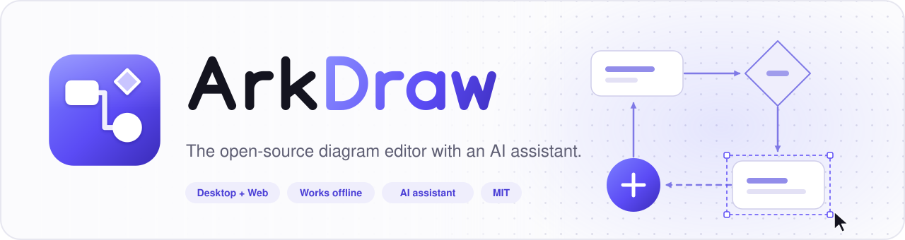
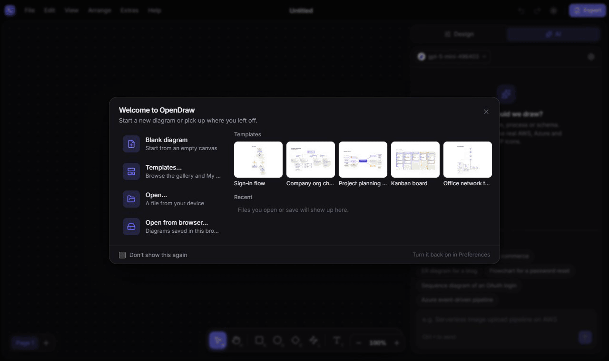
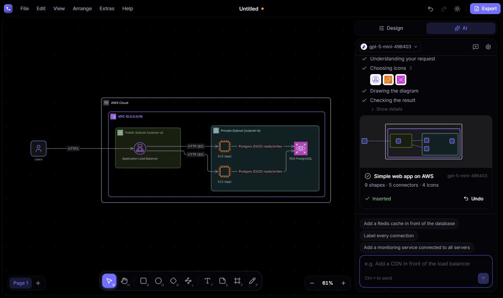
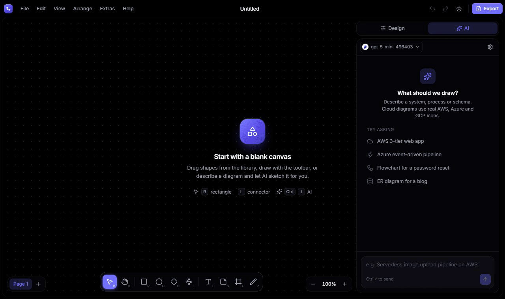
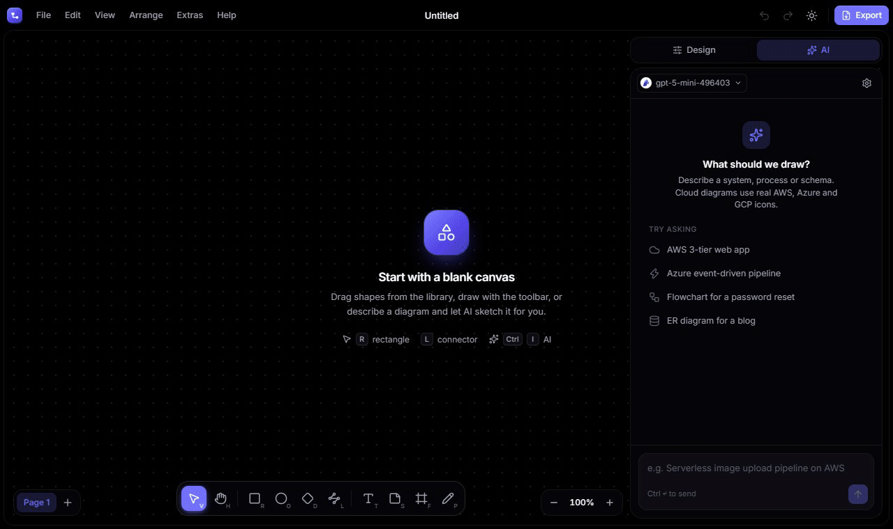

<p align="center">
  <a href="https://github.com/gabe-santana/opendraw">
    <picture>
      <source media="(prefers-color-scheme: dark)" srcset="docs/media/banner-dark.svg">
      
    </picture>
  </a>
</p>

<h3 align="center">Describe a system. Watch it being drawn.</h3>

<p align="center">
  An open-source diagram editor with an AI assistant that draws, edits and animates real architecture diagrams,<br>
  using your own model and keeping your files on your disk.
</p>

<p align="center">
  <a href="https://arkdraw.com"><b>Open it in your browser at arkdraw.com</b></a> · <a href="#download">Download for Windows, macOS and Linux</a>
</p>

<p align="center">
  <a href="https://github.com/gabe-santana/opendraw/releases/latest"></a>
  <a href="LICENSE"></a>
  <a href="https://github.com/gabe-santana/opendraw/actions/workflows/ci.yml"></a>
  
</p>

<p align="center">
  
</p>
<p align="center"><sub>Real recording: one prompt, official AWS icons, routed arrows, animated flow. Nothing edited afterwards.</sub></p>

## The AI assistant

Open the **AI** tab (<kbd>Ctrl</kbd>/<kbd>⌘</kbd> + <kbd>I</kbd>) and say what you need. There is no mode to pick: on an empty canvas it draws, on an existing diagram it edits.

- **Real diagrams.** Native shapes and connectors you can keep editing, never a picture. It uses the official AWS, Azure, Google Cloud, Oracle and Kubernetes icons, and groups them in VPCs, VNets, subnets and resource groups with their logos.
- **Clean layout.** Connectors are routed together, so they don't overlap, don't cross shapes, and each one gets its own port.
- **It edits.** Try "add a cache in front of the database", "label every connection" or "make the failing service pulse". Every change pops in place and is a single <kbd>Ctrl</kbd>+<kbd>Z</kbd> away.
- **It animates.** Ask it to "animate the request flow" or "build it step by step", then export the result as a GIF.
- **Your model, your key.** Anthropic Claude, OpenAI, Google Gemini, xAI Grok, DeepSeek, Mistral, Azure AI Foundry, Amazon Bedrock, Google Vertex AI, OpenRouter, Groq and more, or **Ollama** fully offline. Keys stay in your system keychain (desktop) or encrypted in your browser (web), and requests go straight to your provider. ArkDraw has no servers.

<table>
  <tr>
    <td width="50%" valign="top">
      
      <p align="center"><sub><b>Edit an existing diagram:</b> "Add an ElastiCache Redis cache between the instances and the database, and animate the data flow."</sub></p>
    </td>
    <td width="50%" valign="top">
      
      <p align="center"><sub><b>Azure:</b> "Front Door → App Service inside a VNet, talking to Azure SQL and Key Vault. Animate the traffic."</sub></p>
    </td>
  </tr>
  <tr>
    <td width="50%" valign="top">
      
      <p align="center"><sub><b>Flowcharts too:</b> "Password reset flowchart. Build it step by step."</sub></p>
    </td>
    <td width="50%" valign="top">
      
      <p align="center"><sub><b>Google Cloud:</b> "Pub/Sub → Dataflow → BigQuery, with a Looker dashboard. Show the events moving as dots."</sub></p>
    </td>
  </tr>
</table>

## Download

| OS | Get it |
| --- | --- |
| **Windows** 10/11 | [Microsoft Store](https://apps.microsoft.com/detail/9PG6WQTHD78Q), `winget install 9PG6WQTHD78Q`, or the `windows-installer.exe` from [Releases](https://github.com/gabe-santana/opendraw/releases/latest). Signed by Microsoft, updates automatically |
| **macOS** 11+ | Universal `.dmg` (Apple Silicon and Intel) |
| **Linux** | `.AppImage` (any distro), `.deb`, `.rpm`, x64 and arm64 |
| **Web** | **[arkdraw.com](https://arkdraw.com)**, installable as an app, or [self-host it](docs/web.md) |

Checksums are in `SHA256SUMS.txt` on every release.

<details>
<summary>macOS says the app is from an unidentified developer?</summary>

The macOS build isn't notarized yet: right-click the app in Applications and choose **Open**, or run `xattr -dr com.apple.quarantine` on it.

</details>

## Also in the box

- **Local-first.** `.opendraw` is plain JSON that diffs in git. No account, works offline.
- **Open formats.** Opens and saves `.drawio` and `.vsdx`; imports Mermaid, Graphviz, CSV and SQL.
- **14,000+ icons** with search that forgives typos (`lamda`) and knows acronyms (`vnet`).
- **Straight connectors on demand.** Hover a segment, drag it, and it snaps into line with the shapes.
- **10 languages**, light and dark themes, plugins and custom shapes.

## Quick start

```sh
git clone https://github.com/gabe-santana/opendraw.git && cd opendraw
npm install
npm run icons:fetch   # official cloud icon packs (optional)
npm run dev           # web app at http://localhost:1420
npm run tauri dev     # desktop app (needs Rust)
```

[Features and formats](docs/overview.md) · [Web and self-hosting](docs/web.md) · [CLI export](docs/cli-export.md) · [Plugins](docs/extensibility.md) · [Animation](docs/specs/animation.md) · [Releases](docs/release.md)

> [!NOTE]
> Vendor icon packs are third-party trademarks under their own terms, not MIT. They are downloaded by `npm run icons:fetch`, not committed; see [`public/icons/LICENSES.md`](public/icons/LICENSES.md).

## Contributing

Issues and pull requests are welcome. Start with [CONTRIBUTING.md](CONTRIBUTING.md) and the [`good first issue`](https://github.com/gabe-santana/opendraw/labels/good%20first%20issue) label, follow the [Code of Conduct](CODE_OF_CONDUCT.md), and report vulnerabilities privately ([SECURITY.md](SECURITY.md)).

The GIFs above are recorded from the real app with `npm run media:ai` (AI demos) and `npm run media:gifs` (template animations).

## License

[MIT](LICENSE) © 2026 Gabriel Santana
