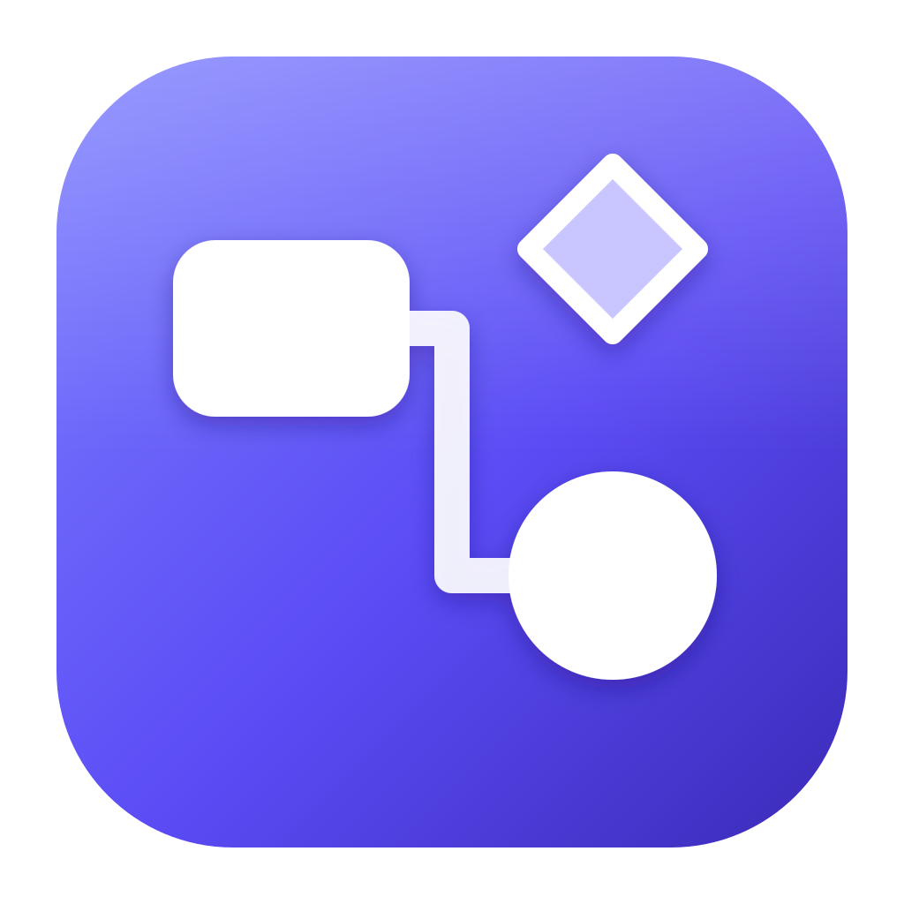

<p align="center">
  <a href="https://github.com/gabe-santana/opendraw">
    <picture>
      <source media="(prefers-color-scheme: dark)" srcset="docs/media/banner-dark.svg">
      
    </picture>
  </a>
</p>

<p align="center">
  <b>Flowcharts, cloud architecture, UML, ER, BPMN and more, as files on your own disk.</b><br>
  A native desktop app and an offline web app from one codebase. Opens and saves draw.io files. No account, no server.
</p>

<p align="center">
  <a href="LICENSE"></a>
  <a href="https://github.com/gabe-santana/opendraw/actions/workflows/ci.yml"></a>
  <a href="#web-vs-desktop"></a>
  <a href="https://tauri.app"></a>
  <a href="https://react.dev"></a>
  <a href="https://www.typescriptlang.org"></a>
  <a href="#contributing"></a>
</p>

<p align="center">
  <a href="#quick-start"><b>Quick start</b></a> ·
  <a href="#feature-tour"><b>Features</b></a> ·
  <a href="#import-and-export"><b>Import &amp; export</b></a> ·
  <a href="#drawio-parity"><b>draw.io parity</b></a> ·
  <a href="#web-vs-desktop"><b>Web vs desktop</b></a> ·
  <a href="docs/web.md"><b>Docs</b></a>
</p>

<!--
  HERO: real capture of the app goes here (docs/media/hero.gif, < 5 MB, ~1100 px wide).
  Shot list: build a small cloud architecture from the Icons tab (search "vnet", then the typo "lamda"),
  drop the icons, connect them and let the connectors auto-route.

<p align="center">
  
</p>
-->

---

## Why OpenDraw

<table>
  <tr>
    <td width="33%" valign="top">
      <h3>Local-first</h3>
      Diagrams are files on your disk. <code>.opendraw</code> is pretty-printed JSON that diffs cleanly in git. Revision history and crash recovery are local too.
    </td>
    <td width="33%" valign="top">
      <h3>No account, ever</h3>
      Nothing leaves your machine unless you configure an AI provider with your own key. Share links carry the diagram in the URL fragment, which never reaches a server.
    </td>
    <td width="33%" valign="top">
      <h3>Desktop and web</h3>
      A small native app for Windows, macOS and Linux (Tauri 2 / Rust), and an installable offline PWA, built from the same React code.
    </td>
  </tr>
  <tr>
    <td valign="top">
      <h3>draw.io-compatible</h3>
      Opens and saves <code>.drawio</code>. Imports Visio, Gliffy, Lucid, Mermaid, CSV and SQL. Familiar shortcuts. <a href="docs/PARITY.md">354 draw.io features tracked</a>.
    </td>
    <td valign="top">
      <h3>Official cloud icons</h3>
      AWS, Azure, Google Cloud, Oracle, Alibaba, IBM and Kubernetes packs plus ~2,000 tech logos, with fuzzy search that forgives typos and maps services across clouds.
    </td>
    <td valign="top">
      <h3>AI, bring your own key</h3>
      Optional. Generate or edit diagrams with Anthropic, OpenAI, Gemini, a local Ollama model, or any OpenAI-compatible endpoint. Desktop keys live in the OS keychain.
    </td>
  </tr>
</table>

## Feature tour

<!--
  MEDIA GRID: real captures go here. Suggested files in docs/media/ (GIFs < 5 MB each):
    templates.gif     File → New from template…, pick one, create it
    quick-flow.gif    type labels, quick-connect arrows, Replace shape…
    export.gif        File → Export, flip through the formats
    dark-mode.gif     View → Dark theme with adaptive diagram colours
    editor-light.png  editor overview (light)
    editor-dark.png   same diagram, dark theme
    hover-card.png    Icons tab hover card with the icon description
    export-dialog.png export dialog

<table>
  <tr>
    <td width="50%"><p align="center"><sub><b>Template gallery</b>: 15 categories with live previews</sub></p></td>
    <td width="50%"><p align="center"><sub><b>Fast editing</b>: type to label, quick-connect, replace shape</sub></p></td>
  </tr>
  <tr>
    <td><p align="center"><sub><b>Export</b>: PNG, SVG, PDF, HTML, VSDX, draw.io, GIF</sub></p></td>
    <td><p align="center"><sub><b>Dark mode</b> that can re-tint diagram colours</sub></p></td>
  </tr>
  <tr>
    <td><p align="center"><sub><b>Icon hover cards</b> explain what each service does</sub></p></td>
    <td><p align="center"><sub><b>The editor</b>: shapes, canvas, Format panel</sub></p></td>
  </tr>
</table>
-->

### Draw

- **Infinite canvas** with grid snapping, smart alignment and equal-spacing guides, rulers (px, pt, in, mm, m), page view with paper sizes, an outline/minimap, and focus mode.
- **Connectors** with orthogonal auto-routing that avoids shapes, plus straight, curved, elbow, entity-relation and isometric styles, waypoints, line jumps and 20 arrowheads including crow's-foot.
- **300+ shapes in 25+ libraries**: General, Flowchart, UML, ER, C4, BPMN 2.0, ArchiMate 3, SysML, Network, Rack, Electrical, P&amp;ID, Floorplan, Lean/VSM, Mockups, Android, iOS, Mind map, Kanban, timeline/Gantt, Venn and more.
- **Template gallery** with 15 categories, live previews and "insert into current diagram".
- **Automatic layouts**: flow, tree, radial, org chart, mind map (with `Tab` / `Ctrl+Enter` tree editing), organic, circle and grid.

### Style and annotate

- Hand-drawn **sketch** style (Rough.js), gradients, glass, shadows, per-fill/stroke/text opacity.
- Formatted labels (a Markdown subset) with **LaTeX math** via MathJax, tables, images, freehand drawing and sticky notes.
- **Animated diagrams**: flow, dots and pulse connectors, shape emphasis, step-by-step build sequences, previewed on the canvas with `Alt+P` and exported as GIF.
- **Dark mode** for the UI that can also re-tint diagram colours.

### Organise

- Multi-page documents, layers (hide, lock, reorder), tags with a tag filter, groups and collapsible containers.
- Edit Data (custom properties, tooltips, links, `%placeholder%` labels), raw Edit Style, and Edit Diagram as JSON.
- Find and replace (regex, all pages), a **command palette** (`Ctrl/⌘+K`), and draw.io-compatible shortcuts generated from one action registry.
- Comment threads stored in the file, local revision history, a Scratchpad, and custom libraries (`.opendrawlib`; draw.io `<mxlibrary>` files import too).

## Quick start

```sh
git clone https://github.com/gabe-santana/opendraw.git
cd opendraw
npm install            # .npmrc sets legacy-peer-deps
npm run icons:fetch    # optional: download the official vendor icon packs into public/icons
npm run dev            # web edition at http://localhost:1420
npm run tauri dev      # desktop app (starts the dev server for you)
```

`icons:fetch` downloads each vendor's official archive, sanitises the SVGs and writes manifests to `public/icons/`. Without it the app works normally; the Icons tab just shows a hint instead of the vendor packs. Set `GITHUB_TOKEN` if you hit GitHub API rate limits.

<details>
<summary><b>Prerequisites</b> (Node, Rust, and per-OS Tauri dependencies)</summary>

<br>

- [Node.js](https://nodejs.org/) 20+ (CI uses 22).
- [Rust](https://rustup.rs/) stable. Only the desktop app needs it; the web build doesn't.
- Platform dependencies for Tauri:
  - **Windows**: Microsoft C++ Build Tools (MSVC) and WebView2. WebView2 ships with Windows 10 (1803+) and 11.
    ```powershell
    winget install Microsoft.VisualStudio.2022.BuildTools --override "--add Microsoft.VisualStudio.Workload.VCTools --includeRecommended"
    ```
  - **macOS**: Xcode Command Line Tools (`xcode-select --install`).
  - **Linux (Debian/Ubuntu)**: the packages CI installs:
    ```sh
    sudo apt-get install -y libwebkit2gtk-4.1-dev libappindicator3-dev librsvg2-dev patchelf
    ```
  - The [Tauri prerequisites guide](https://tauri.app/start/prerequisites/) covers other distributions.

</details>

<details>
<summary><b>Building installers and releasing</b></summary>

<br>

```sh
npm run tauri build                 # installers for the current OS
npm run app:build:mac-universal     # macOS universal (Apple Silicon + Intel)
```

Bundles are written to `src-tauri/target/release/bundle/` (the universal macOS build goes to `src-tauri/target/universal-apple-darwin/release/bundle/`).

| OS | Formats | Config |
| --- | --- | --- |
| Windows | MSI (WiX) and NSIS `.exe` (per-user install, WebView2 bootstrapper) | `src-tauri/tauri.windows.conf.json` |
| macOS | `.app` and `.dmg` (universal in CI, macOS 11+) | `src-tauri/tauri.macos.conf.json` |
| Linux | AppImage and `.deb` | `src-tauri/tauri.linux.conf.json` |

**Releases are driven by tags.** Pushing a tag that matches `v*` runs `.github/workflows/release.yml`, which builds on Windows, macOS (universal) and Ubuntu 22.04, runs `icons:fetch` (a vendor download failure doesn't block the release), and attaches the installers to a **draft** GitHub release named `OpenDraw <tag>`.

```sh
# bump "version" in package.json, src-tauri/tauri.conf.json and src-tauri/Cargo.toml, then:
git tag v0.1.0 && git push origin v0.1.0
```

The workflow doesn't configure code signing or notarisation, so installers are unsigned unless you add the Tauri signing secrets.

</details>

## Web vs desktop

Both editions come from the same Vite build. At runtime `isTauri()` (`src/lib/platform.ts`) picks the shell; in a plain browser, `src/web/boot.tsx` adds the web-only pieces.

| | Desktop (Tauri) | Web / PWA |
| --- | --- | --- |
| **Files** | Native open/save dialogs, atomic writes, recent files, `.opendraw` file association | File picker / `showSaveFilePicker`, downloads |
| **Offline** | Always | Installable PWA; the app shell is precached, icon packs are cached on first use |
| **AI keys** | OS keychain; requests are sent by Rust | Held in memory for the tab only |
| **CLI export** | `opendraw --export …` | — |
| **Sharing** | Export as link | `#R…` share links, `?viewer=1` read-only viewer, `?embed=1` postMessage embed API, `?url=` |
| **Deploy** | Installers | Static `dist/`, Docker + nginx, Netlify, Cloudflare Pages, Vercel, GitHub Pages |

```sh
npm run build:web && npm run preview:web    # http://localhost:4173, service worker active
npm run docker:build && npm run docker:run  # http://localhost:8080
```

[`docs/web.md`](docs/web.md) is the full reference for self-hosting the web edition: URL parameters, the share-link format, the viewer, the embed protocol and its security model, PWA behaviour, the Docker image and CSP, and static hosting.

## Import and export

| Format | Import | Export | Notes |
| --- | :---: | :---: | --- |
| OpenDraw `.opendraw` | ✓ | ✓ | Pretty-printed JSON, git-friendly |
| draw.io / diagrams.net `.drawio`, `.xml` | ✓ | ✓ | Compressed or plain; `flow` animation survives as `flowAnimation=1` |
| PNG / SVG / PDF with an embedded diagram | ✓ | ✓ | "Include a copy of the diagram" makes the image re-editable |
| PNG, JPEG, WebP | | ✓ | Scale, border, transparent background, selection only |
| SVG | | ✓ | Same renderer as the canvas |
| PDF | | ✓ | Vector, multi-page, page ranges |
| HTML | | ✓ | Self-contained and interactive |
| Visio `.vsdx` | ✓ | ✓ | Import is best-effort (also `.vssx` stencils) |
| Gliffy | ✓ | | Best-effort |
| Lucid | ✓ | | Standard Import format |
| Mermaid | ✓ | | Flowchart, sequence, class, ER, state, mindmap, converted to native shapes |
| CSV | ✓ | | draw.io-style CSV |
| SQL | ✓ | | `CREATE TABLE` DDL becomes an ER diagram |
| Text | ✓ | | Indented lists or `a -> b` edges |
| Animated GIF | | ✓ | Encoded in a Web Worker, matches the canvas preview |
| Share link | ✓ | ✓ | Diagram compressed into the URL fragment |

Exports can use light, dark or automatic appearance, include the grid, and be printed or copied to the clipboard as PNG or SVG.

## draw.io parity

Every feature in draw.io's inventory ([`DRAWIO_FEATURES.md`](DRAWIO_FEATURES.md)) is checked against the code in [`docs/PARITY.md`](docs/PARITY.md):

| Implemented | Partial | Missing | Out of scope | Total |
| :---: | :---: | :---: | :---: | :---: |
| **234** | **62** | **37** | **21** | **354** |

The main gaps are shape-engine depth (no parametric handles or custom connection points yet), some vendor libraries (Cisco, Citrix, Office/M365, OpenStack, …) and customisation (plugins, UI languages). Cloud storage integrations and real-time multi-user editing are out of scope by design; OpenDraw shares through files, share links, the read-only viewer, the embed API, HTML export and in-file comments instead.

## Cloud icon packs and licensing

| Pack | Icons | Pack | Icons |
| --- | ---: | --- | ---: |
| AWS | 810 | Alibaba Cloud | 270 |
| Microsoft Azure | 627 | IBM Cloud | 211 |
| Google Cloud | 261 | Kubernetes | 39 |
| Oracle OCI | 180 | Tech logos (Iconify `logos`) | 2,016 |

Counts come from the last `icons:fetch` (`public/icons/providers.json`). Search is fuzzy: it handles typos ("lamda"), acronyms and cross-cloud synonyms ("vnet"), and icons come with one-line descriptions shown in a hover card.

> [!IMPORTANT]
> **The vendor icons are not MIT-licensed.** They're third-party trademarks, used under each vendor's own terms for drawing architecture diagrams, so they aren't committed to this repo: `.gitignore` excludes them, `npm run icons:fetch` downloads them, and the release workflow bundles them into installers. [`public/icons/LICENSES.md`](public/icons/LICENSES.md) lists the source, version and terms of every pack; read it before you redistribute a build. The icon descriptions (`public/icons/*/descriptions.json`) are OpenDraw's own.

## Command-line export

The desktop binary exports without opening a window, for CI and docs pipelines:

```sh
opendraw --export architecture.opendraw --format png --output architecture.png --scale 2
opendraw -x flows.drawio -f pdf --all-pages --embed -o flows.pdf
```

Formats: PNG, SVG, PDF, JPG, WebP, HTML, VSDX, draw.io and URL. Rendering runs in the hidden WebView, so the output matches the Export dialog. See [`docs/cli-export.md`](docs/cli-export.md) for every option, exit codes and Windows notes.

<details>
<summary><b>AI assistant (bring your own key)</b></summary>

<br>

*Extras → Generate with AI…* (`Ctrl/⌘+I`) opens a panel with two modes:

- **Generate** creates a diagram from a prompt; insert it or replace the current diagram.
- **Edit** changes the existing diagram ("add a CDN in front of the load balancer").

The model works in a tool-calling loop: it searches the installed icon packs (`search_icons`), then submits a diagram spec or a list of edit operations, which OpenDraw validates, lays out and turns into native shapes (`src/ai/generate/`).

| Provider | Notes |
| --- | --- |
| Anthropic | Claude models |
| OpenAI | |
| Google Gemini | |
| Ollama | Local, no key needed; configurable endpoint |
| Custom endpoint | OpenAI-compatible; bearer or `api-key` auth (Azure OpenAI) |

Configure it in *Extras → AI provider & API key…*.

- **Desktop:** keys are stored in the OS keychain. Requests are sent by Rust (`src-tauri/src/ai.rs`), which adds the auth header itself, talks only to the provider's host (or the endpoint the key was saved for), doesn't follow redirects, and never hands the key back to the WebView.
- **Browser:** keys stay in memory for the current tab only, and the UI shows a warning.

</details>

<details>
<summary><b>Animation and GIF export</b></summary>

<br>

- Connectors can animate as **flow** (marching dashes), **dots** (travelling along the path) or **pulse** (the stroke glows and fades).
- Shapes can pulse, glow or bounce, and elements can get a **build-sequence step** so they reveal one after another.
- Set it up in the Format panel's **Animation** section and preview on the canvas with `Alt+P`.

*File → Export → GIF* renders frames with the same SVG renderer as the canvas and encodes them in a Web Worker (`gifenc`), so the GIF matches the preview. See [`docs/specs/animation.md`](docs/specs/animation.md).

</details>

<details>
<summary><b>Project structure</b></summary>

<br>

```
.
├── src/                  React + TypeScript front end (shared by desktop and web)
│   ├── app/              action/shortcut registry, commands, file lifecycle, clipboard, print, revisions
│   ├── canvas/           SVG canvas, interactions, snapping, text editor, shape picker
│   ├── chrome/           title bar and menus, toolbar, dialogs (export, templates, …), page tabs, outline
│   ├── panels/           shapes/icons/layers panel and the Format panel
│   ├── model/ store/     document model, Zustand stores (document + history, UI state)
│   ├── shapes/           shape registry, built-in libraries, rich-text and sketch renderers
│   ├── icons/ search/    vendor icon packs, fuzzy search for shapes, icons and templates
│   ├── layout/           auto-layout algorithms (auto-discovered)
│   ├── templates/        template gallery
│   ├── io/               .opendraw format, draw.io interop, importers, exporters, VSDX writer
│   ├── ai/               provider adapters, agent loop, spec → diagram
│   ├── animation/        animation timeline
│   ├── viewer/ web/      read-only viewer, web boot, share links, embed API, PWA
│   └── lib/ ui/          geometry, connector routing, platform detection, UI primitives
├── src-tauri/            Tauri 2 shell (Rust): file I/O, recent files, CLI export, AI keychain + HTTP
├── public/               static assets, PWA manifest, vendor icon packs (fetched)
├── scripts/              icon pack builder, PWA icon generator, CSP generator
├── test/                 Vitest suites
├── docs/                 web edition, CLI export, animation spec, draw.io parity
└── deploy/, Dockerfile   nginx image for the web edition
```

</details>

<details>
<summary><b>npm scripts</b></summary>

<br>

| Script | What it does |
| --- | --- |
| `npm run dev` | Vite dev server on http://localhost:1420 (web edition, no service worker) |
| `npm run build` | Typecheck and production build to `dist/` (used by Tauri) |
| `npm run typecheck` / `npm test` | `tsc --noEmit` / Vitest suites |
| `npm run tauri <cmd>` | Tauri CLI, e.g. `npm run tauri dev`, `npm run tauri build` |
| `npm run app:build:mac-universal` | `tauri build --target universal-apple-darwin` |
| `npm run app:icons` / `pwa:icons` | Regenerate desktop / PWA icons from `app-icon.svg` |
| `npm run icons:fetch` | Download and sanitise vendor icon packs into `public/icons/` |
| `npm run icons:check-descriptions` | Check icon description coverage |
| `npm run build:web` / `preview:web` | Web build with `dist/_headers` (CSP, caching) / serve it on :4173 with the service worker |
| `npm run docker:build` / `docker:run` | Build and run the nginx image on port 8080 |

</details>

## Contributing

Issues and pull requests are welcome. For larger changes, please open an issue first so the design can be discussed. Before opening a PR, run the same checks as CI:

```sh
npm run typecheck && npm test && npm run build
cargo clippy --manifest-path src-tauri/Cargo.toml -- -D warnings   # if you touched Rust
```

The code is built to be extended:

- **Importers**: add a module to `src/io/import/` that exports `importer` (see `src/io/import/types.ts`).
- **Layouts**: add a module to `src/layout/` that exports `layout`.
- **Shape libraries**: add a module to `src/shapes/libs/`; the registry discovers it.
- **Commands and shortcuts**: add an entry to `src/app/actions.tsx`. Menus, the context menu, shortcuts and the command palette are all generated from it.

Looking for something to work on? The partial and missing items in [`docs/PARITY.md`](docs/PARITY.md) are a good place to start.

## License

[MIT](LICENSE) © 2026 Gabriel Santana.

Vendor icon packs fetched into `public/icons/` are **not** covered by the MIT license; see [`public/icons/LICENSES.md`](public/icons/LICENSES.md).

<br>

<p align="center">
  <br>
  <sub>Made for people who'd rather own their diagrams.</sub>
</p>
