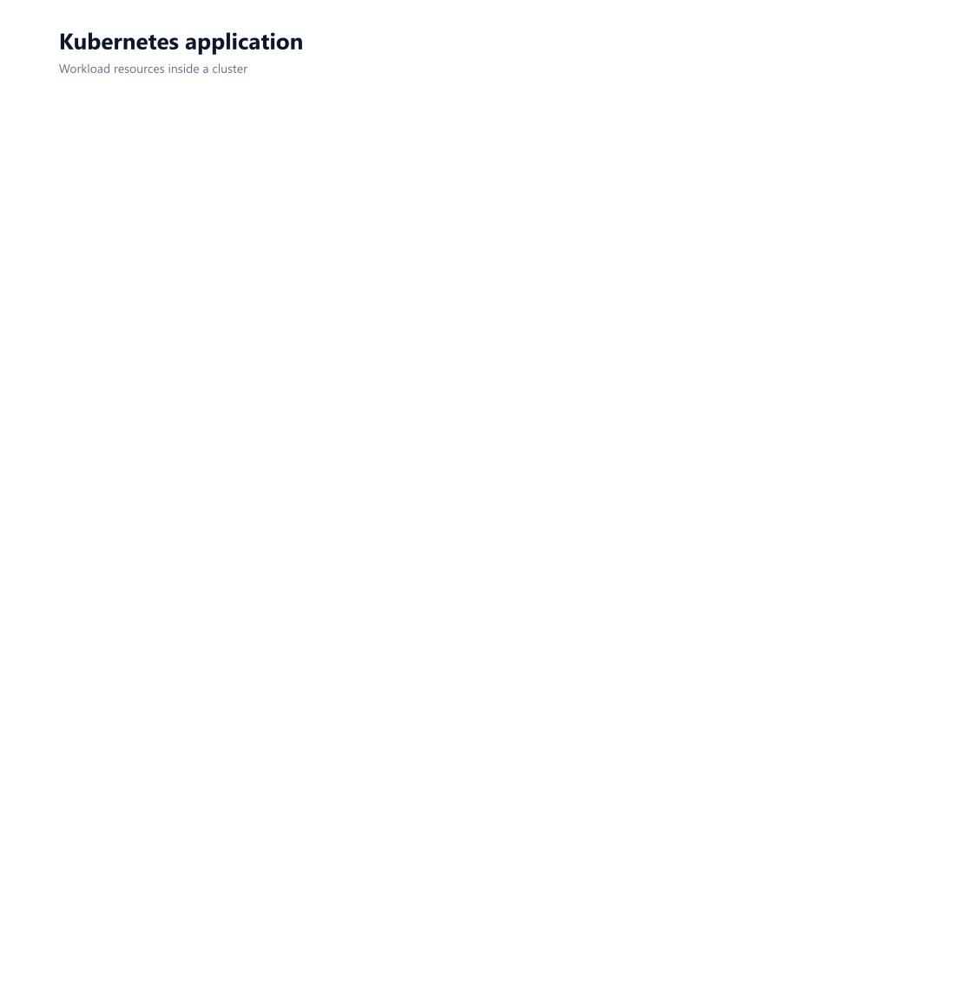
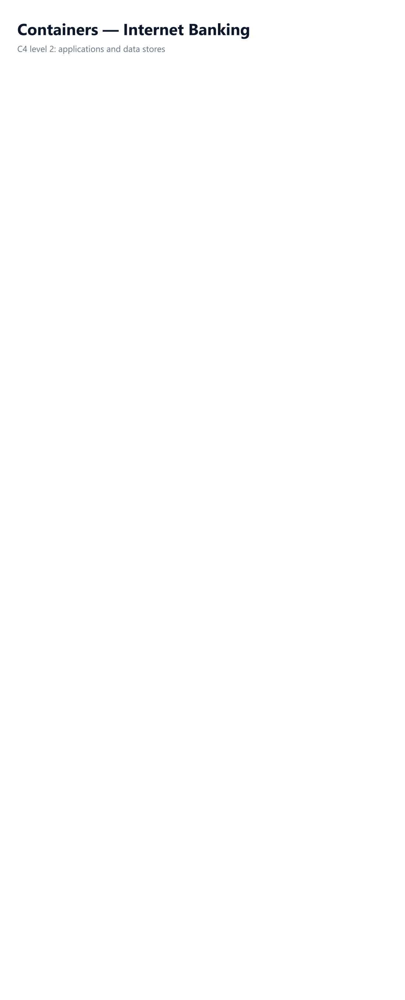

<p align="center">
  <a href="https://github.com/gabe-santana/opendraw">
    <picture>
      <source media="(prefers-color-scheme: dark)" srcset="docs/media/banner-dark.svg">
      
    </picture>
  </a>
</p>

<p align="center">
  <b>The open-source diagram editor that keeps your diagrams on your disk.</b><br>
  Desktop and web, offline, open formats, official cloud icons and AI that uses your own key.
</p>

<p align="center">
  <a href="LICENSE"></a>
  <a href="https://github.com/gabe-santana/opendraw/actions/workflows/ci.yml"></a>
  
  <a href="https://tauri.app"></a>
</p>

<p align="center">
  
</p>

## Why OpenDraw

- **Your files, your disk.** `.opendraw` is plain JSON that diffs in git. No account, no server, works offline.
- **Desktop and web from one codebase.** A small native app for Windows, macOS and Linux, plus an installable PWA.
- **Open formats.** Opens and saves `.drawio` and `.vsdx`; imports Mermaid, Graphviz, CSV, SQL and other common diagram exports.
- **14,000+ icons.** Official AWS, Azure, Google Cloud, Oracle, Alibaba, IBM and Kubernetes packs, with search that forgives typos (`lamda`) and knows acronyms (`vnet`).
- **Diagrams that move.** Build-up sequences and flowing connectors, exported as GIF. Every animation on this page comes from the same animation engine.
- **AI, bring your own key.** Describe a system and get a native, editable diagram from Claude, GPT, Gemini or a local model.

## See it in action

<table>
  <tr>
    <td width="50%"><p align="center"><sub><b>AWS three-tier</b></sub></p></td>
    <td width="50%"><p align="center"><sub><b>Google Cloud data pipeline</b></sub></p></td>
  </tr>
</table>
<table>
  <tr>
    <td width="34%"><p align="center"><sub><b>Azure web app</b></sub></p></td>
    <td width="33%"><p align="center"><sub><b>Kubernetes</b></sub></p></td>
    <td width="33%"><p align="center"><sub><b>C4 model</b></sub></p></td>
  </tr>
</table>

<sub>Each one is a template from **File → New from template…**, animated with the app's build sequence and flow effects. Regenerate them with `npm run media:gifs`.</sub>

<!-- AI DEMO: docs/media/ai/*.gif (real generations; prompt shown above the diagram) -->

## Quick start

```sh
git clone https://github.com/gabe-santana/opendraw.git && cd opendraw
npm install
npm run icons:fetch   # optional: official cloud icon packs
npm run dev           # web app at http://localhost:1420
npm run tauri dev     # desktop app (needs Rust; on Windows also the MSVC Build Tools)
```

Installers for every OS are built by `npm run tauri build` or by pushing a `v*` tag ([release guide](docs/release.md)).

## Learn more

[Features and formats](docs/overview.md) · [Web edition and self-hosting](docs/web.md) · [Command-line export](docs/cli-export.md) · [Plugins and custom shapes](docs/extensibility.md) · [Animation](docs/specs/animation.md)

> [!IMPORTANT]
> Vendor icon packs are third-party trademarks under their own terms, not MIT. They are downloaded by `npm run icons:fetch`, not committed; see [`public/icons/LICENSES.md`](public/icons/LICENSES.md).

## Contributing

Issues and pull requests are welcome — start with [CONTRIBUTING.md](CONTRIBUTING.md) and the [`good first issue`](https://github.com/gabe-santana/opendraw/labels/good%20first%20issue) label. Please follow the [Code of Conduct](CODE_OF_CONDUCT.md) and report vulnerabilities privately ([SECURITY.md](SECURITY.md)).

## License

[MIT](LICENSE) © 2026 Gabriel Santana
